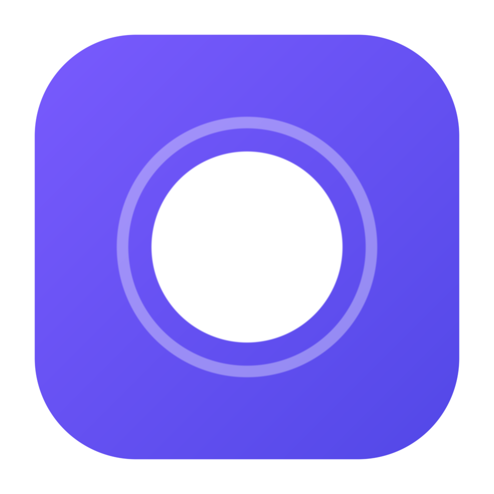
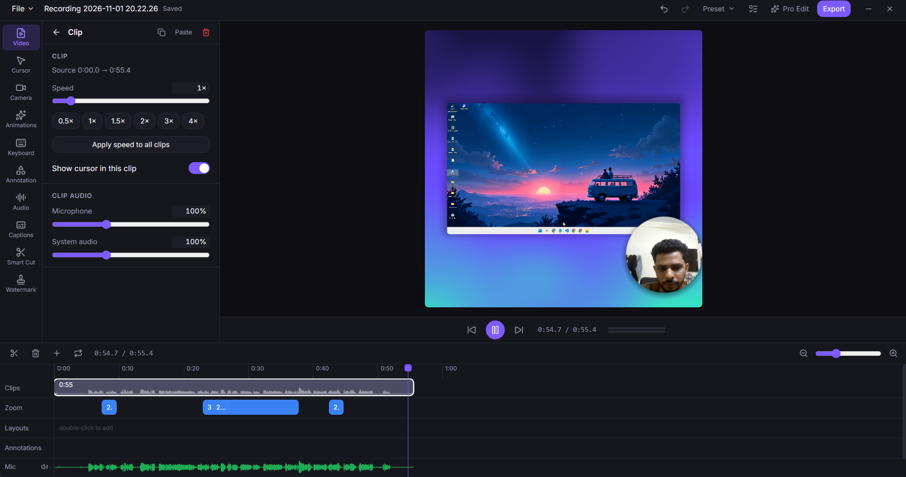
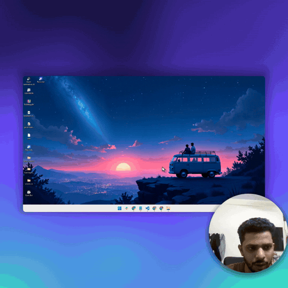
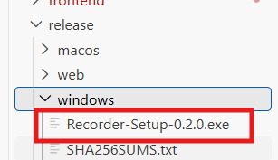
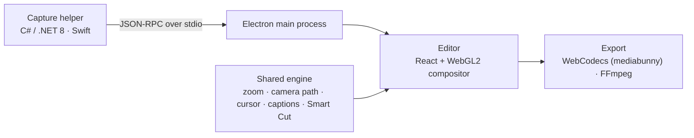

<div align="center">



# Open-Recorder

**The free, open-source screen recorder that edits for you.**

Record your screen and get a polished video automatically — smooth auto-zoom on every click, a crisp animated
cursor, camera layouts, captions and clean audio — then export for YouTube, Shorts, Reels, TikTok or LinkedIn
in one click.

[](https://github.com/Sahil-Chandel/Open-Recorder/releases/latest)
[](https://github.com/Sahil-Chandel/Open-Recorder/releases)
[](LICENSE)
[](#installation)
[](CONTRIBUTING.md)

[**Download for Windows**](https://github.com/Sahil-Chandel/Open-Recorder/releases/latest) ·
[Features](#features) ·
[Installation](#installation) ·
[Build from source](#build-from-source) ·
[Contributing](#contributing)

</div>

<br />

<p align="center">
  
</p>

## See it in action

<p align="center">
  <a href="docs/assets/demo.mp4">
    
  </a>
  <br />
  <sub>Recorded and exported with Open-Recorder using the <b>LinkedIn feed (1:1)</b> preset.
  <a href="docs/assets/demo.mp4"><b>▶ Watch the full demo with sound (MP4, 43 s)</b></a></sub>
</p>

## Why Open-Recorder?

- **It edits for you.** Zooms follow your clicks and typing, the cursor is smoothed and enlarged, your camera is
  laid out and captions are written — before you touch the timeline.
- **Private by design.** Everything runs on your computer. No account, no cloud, no telemetry.
- **Free and open source.** Every feature, no watermark, no time limit — licensed under GPL-3.0.
- **Made for social.** One recording, exported in the right shape for every platform, with safe-zone guides.

## Features

| | |
|---|---|
| 🎥 **Recording** | Full screen, a single window or a custom area. Webcam, microphone and system audio (or just one app's audio) as separate tracks. Pause / resume, countdown, teleprompter and crash recovery. Record Android phones over USB. |
| 🔍 **Auto zoom & pan** | Zooms generated from your clicks and typing, with spring-physics camera motion and an optional 3D motion style. Every zoom stays editable on the timeline. |
| 🖱️ **Cursor** | 40 cursor styles, motion smoothing, click effects and sounds, hide-when-idle and motion blur. |
| 🧑‍💻 **Camera** | Camera layouts with animated transitions, background removal, blur and virtual scenes, a beauty filter, and support for a separately recorded face-cam video. |
| ✂️ **Editor** | Trim, speed and crop; annotations (text, shapes, blur, spotlight, magnifier, callouts); keyboard-shortcut overlay; backgrounds including looping videos; chapters you can copy as YouTube chapters; watermark; reusable presets. |
| 🎙️ **Audio** | Noise reduction, vocal enhancement, loudness balancing and a music library with automatic ducking. |
| 💬 **Captions & Smart Cut** | On-device speech recognition (whisper.cpp) in 11+ languages, burned-in captions, SRT / VTT export, and one-click removal of filler words and silences. |
| ⚡ **Pro Edit** | One click runs Smart Cut, captions, noise reduction, zooms and your default preset. |
| 📤 **Export** | MP4 (H.264 + AAC) or GIF up to 4K at 60 fps, with hardware encoding on NVIDIA, AMD and Intel GPUs. "Made for" presets for YouTube, Shorts, Instagram Reels and posts, TikTok, LinkedIn, X and Facebook — export several platform versions in one go. |

## Installation

### Windows

1. Download **`Open-Recorder-Setup-0.2.0.exe`** from the
   [latest release](https://github.com/Sahil-Chandel/Open-Recorder/releases/latest).
2. Run the installer, choose a folder and click **Install**. Open-Recorder is added to the Start menu and the
   desktop.

   

3. The installer is not code-signed yet, so Windows SmartScreen may say *"Windows protected your PC"*.
   Click **More info → Run anyway**.

Everything the app needs — the capture engine, the .NET runtime and FFmpeg — is included; there is nothing else
to install. Caption models, the background-removal model and Android platform-tools are downloaded once, the
first time you use those features.

**Requirements:** Windows 10 version 2004 or later (64-bit). A GPU with hardware video encoding is recommended
for 4K recording; a software encoder is used otherwise.

### macOS

macOS support (ScreenCaptureKit) is **experimental** and there is no prebuilt download yet. You can
[build it from source](#build-from-source) on a Mac running macOS 13 or later.

## Quick start

1. Open **Open-Recorder** and choose **Full Screen**, **Window**, **Custom** or **Device**.
2. Turn the camera, microphone and system audio on or off.
3. Click **Start recording**. Finish from the control bar or with <kbd>Alt</kbd>+<kbd>Shift</kbd>+<kbd>S</kbd>.
4. The editor opens with zooms, cursor effects and your camera layout already applied. Pick a **Made for**
   preset (for example *LinkedIn feed*) and click **Export**.

### Keyboard shortcuts

| Action | Windows | macOS |
|---|---|---|
| New recording | <kbd>Alt</kbd>+<kbd>Shift</kbd>+<kbd>N</kbd> | <kbd>⌘</kbd>+<kbd>⌥</kbd>+<kbd>N</kbd> |
| Record full screen | <kbd>Alt</kbd>+<kbd>Shift</kbd>+<kbd>1</kbd> | <kbd>⌘</kbd>+<kbd>⌥</kbd>+<kbd>1</kbd> |
| Record a custom area | <kbd>Alt</kbd>+<kbd>Shift</kbd>+<kbd>2</kbd> | <kbd>⌘</kbd>+<kbd>⌥</kbd>+<kbd>2</kbd> |
| Record a window | <kbd>Alt</kbd>+<kbd>Shift</kbd>+<kbd>3</kbd> | <kbd>⌘</kbd>+<kbd>⌥</kbd>+<kbd>3</kbd> |
| Pause / resume | <kbd>Alt</kbd>+<kbd>Shift</kbd>+<kbd>P</kbd> | <kbd>⌘</kbd>+<kbd>⌥</kbd>+<kbd>P</kbd> |
| Finish recording | <kbd>Alt</kbd>+<kbd>Shift</kbd>+<kbd>S</kbd> | <kbd>⌘</kbd>+<kbd>⌥</kbd>+<kbd>S</kbd> |
| Pause keystroke capture | <kbd>Alt</kbd>+<kbd>Shift</kbd>+<kbd>K</kbd> | <kbd>⌘</kbd>+<kbd>⌥</kbd>+<kbd>K</kbd> |

All shortcuts can be changed in **Settings → Shortcuts**.

## How it works



- A small **native capture helper** per OS records the screen without the cursor (Windows Graphics Capture /
  ScreenCaptureKit), encodes H.264 on the GPU, captures audio tracks and logs clicks, keystrokes and cursor
  shapes. It runs as a separate process, so a capture problem never takes the editor down.
- A **shared TypeScript engine** turns those events into zoom and camera paths (spring physics), smoothed cursor
  motion, layouts, caption timing and Smart Cut edits. It is pure, deterministic and unit-tested.
- The **editor** renders everything live with a WebGL2 compositor, and **export** re-renders frame by frame
  with WebCodecs into MP4, or through FFmpeg into GIF.

## Build from source

**Prerequisites:** [Node.js](https://nodejs.org/) 24, [FFmpeg](https://ffmpeg.org/) on your `PATH`,
the [.NET 8 SDK](https://dotnet.microsoft.com/download/dotnet/8.0) on Windows, or the Xcode command-line tools
on macOS.

```bash
git clone https://github.com/Sahil-Chandel/Open-Recorder.git
cd Open-Recorder

# Windows only: build the capture helper once (the app finds it automatically)
dotnet build -c Release backend/native/win-helper

cd frontend
npm ci
npm test               # engine, desktop and website test suites
npm run dev:desktop    # start the app with hot reload
```

Create an installer:

```bash
cd frontend
npm run dist:win -w desktop   # → frontend/desktop/release/Open-Recorder-Setup-<version>.exe
npm run dist:mac -w desktop   # on a Mac → frontend/desktop/release/Open-Recorder-<version>-<arch>.dmg
```

`dist:*` bundles the capture helper and FFmpeg (taken from `FFMPEG_DIR`, or from your `PATH`).

## Project structure

```text
Open-Recorder/
├── frontend/
│   ├── shared/     # TypeScript engine: project schema, time model, springs, auto zoom, camera path,
│   │               # cursor, layouts, captions, Smart Cut, presets and social formats (unit-tested)
│   ├── desktop/    # Electron app: main process, recorder, editor, WebGL2 compositor, export
│   └── web/        # Project website with in-browser screen, camera and microphone recorders
├── backend/
│   └── native/
│       ├── win-helper/   # Windows capture helper (C# / .NET 8)
│       └── mac-helper/   # macOS capture helper (Swift)
├── docs/assets/    # Screenshots and demo media used in this README
└── scripts/        # Developer utilities
```

## Tech stack

[Electron](https://www.electronjs.org/) · [React](https://react.dev/) · [TypeScript](https://www.typescriptlang.org/) ·
[Zustand](https://github.com/pmndrs/zustand) · [Tailwind CSS](https://tailwindcss.com/) · WebGL2 ·
[Mediabunny](https://github.com/Vanilagy/mediabunny) (WebCodecs) · [FFmpeg](https://ffmpeg.org/) ·
.NET 8 with [NAudio](https://github.com/naudio/NAudio) · Swift / ScreenCaptureKit ·
[whisper.cpp](https://github.com/ggml-org/whisper.cpp) · [MediaPipe](https://ai.google.dev/edge/mediapipe) ·
[Vitest](https://vitest.dev/)

## Privacy

Recordings, projects and exports never leave your computer. There is no account, no server and no telemetry.
Typed characters are never stored — only shortcut combinations, for the keyboard overlay — and keystroke capture
can be paused at any time. Details: [PRIVACY.md](frontend/desktop/build/legal/PRIVACY.md).

## Roadmap

- [ ] Code-signed Windows installer (no SmartScreen prompt)
- [ ] Signed and notarized macOS release
- [ ] In-app updates

Have an idea? [Open a feature request](https://github.com/Sahil-Chandel/Open-Recorder/issues/new).

## Contributing

Contributions are welcome — bug reports, ideas, documentation and code. Please read
[CONTRIBUTING.md](CONTRIBUTING.md) to get set up, and report security issues as described in
[SECURITY.md](SECURITY.md).

If Open-Recorder is useful to you, consider giving the project a ⭐ — it helps others find it.

## License

Open-Recorder is free software, released under the [GNU General Public License v3.0](LICENSE).

The installers include FFmpeg as a separate program; it and the other bundled components keep their own
licenses — see [THIRD_PARTY_NOTICES.md](frontend/desktop/build/legal/THIRD_PARTY_NOTICES.md).

## Acknowledgements

Open-Recorder stands on the shoulders of great open-source projects, including
[FFmpeg](https://ffmpeg.org/), [Electron](https://www.electronjs.org/),
[Mediabunny](https://github.com/Vanilagy/mediabunny), [whisper.cpp](https://github.com/ggml-org/whisper.cpp),
[MediaPipe](https://ai.google.dev/edge/mediapipe) and [NAudio](https://github.com/naudio/NAudio).
